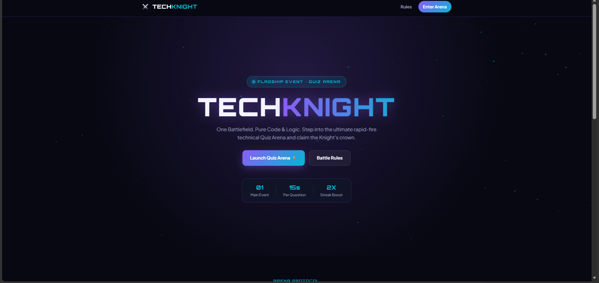

⚔️ TechKnight Quiz Arena

An interactive, lightweight web-based quiz arena built with vanilla HTML, CSS, and JavaScript. Designed for fast gameplay, clean styling, and easy question customization.

Live Demo: [Add your GitHub Pages / Netlify / Vercel link here]

📸 Preview

✨ Features

Interactive Quiz Interface: Built cleanly with vanilla web technologies for fast performance.

Modular Question Bank: Questions are managed separately in questions.js for easy editing and expansion.

Custom Styling: Responsive layout and visual polish handled in style.css.

Zero Backend Required: Runs completely in the browser with no external build tools or databases needed.

📁 Project Structure

techknight-quiz-arena/
├── index.html     # Main markup and quiz container
├── style.css      # Layout, theme, and responsive styles
├── questions.js   # Quiz questions, options, and answers data
└── script.js      # Quiz logic, state handling, and DOM updates

🚀 How to Run Locally

Clone or extract the repository:

git clone https://github.com/<your-username>/techknight-quiz-arena.git
cd techknight-quiz-arena

Launch the app:

Open index.html directly in your browser, or

Run it with Live Server in VS Code for instant reload while editing.

🛠️ Customization

Questions: Edit or add new quiz items inside questions.js.

Design & Colors: Update visual themes, fonts, and layout rules inside style.css.

Game Logic: Modify scoring, timers, or quiz flow inside script.js.

🗺️ Future Improvements

[ ] Add a countdown timer per question

[ ] Save high scores using localStorage

[ ] Add category or difficulty filters

📄 License

This project is open-source and available under the MIT License.
